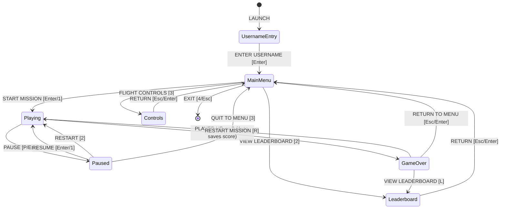

# Space Defender: 2D Arcade Space Shooter

[](https://isocpp.org/)
[](https://www.sfml-dev.org/)
[-brightgreen.svg)](https://www.mingw-w64.org/)
[](https://cmake.org/)
[](LICENSE)

An arcade 2D space shooter built in modern **C++17** and **SFML 2.6.2**, designed to demonstrate practical **Object-Oriented Programming (OOP)**, **Data Structures & Algorithms (DSA)**, and **Game Engine Architecture** in a high-performance, real-time application.

---

## Table of Contents

1. [Project Overview](#1-project-overview)
2. [Technology Stack & Toolchain](#2-technology-stack--toolchain)
3. [Gameplay Mechanics & Features](#3-gameplay-mechanics--features)
4. [Data Structures & Algorithms (DSA) Concepts](#4-data-structures--algorithms-dsa-concepts)
5. [Project Architecture & Directory Structure](#5-project-architecture--directory-structure)
6. [Prerequisites & Environment Setup](#6-prerequisites--environment-setup)
7. [Step-by-Step Build Instructions](#7-step-by-step-build-instructions)
8. [Antigravity IDE Workflow](#8-antigravity-ide-workflow)
9. [Flight Controls & Input Mapping](#9-flight-controls--input-mapping)
10. [Game Screens & Finite State Machine](#10-game-screens--finite-state-machine)
11. [Leaderboard System & File Persistence](#11-leaderboard-system--file-persistence)
12. [Sorting Algorithms Comparison & Benchmarks](#12-sorting-algorithms-comparison--benchmarks)
13. [Searching Algorithms Comparison](#13-searching-algorithms-comparison)
14. [Procedural 8-Bit Audio Synthesis](#14-procedural-8-bit-audio-synthesis)
15. [Visual Effects & Parallax Starfield](#15-visual-effects--parallax-starfield)
16. [Automated Testing & Master Regression Suite](#16-automated-testing--master-regression-suite)
17. [Future Roadmap & Extensions](#17-future-roadmap--extensions)

---

## 1. Project Overview

**Space Defender** puts the player in command of a starfighter defending Earth's perimeter against relentless alien raider squadrons. The project was developed through an 8-phase engineering lifecycle:
- High-precision 60 FPS game loop with delta-time integration.
- Normalized 8-direction flight kinematics with screen boundary clamping.
- Dual-laser weapon systems with cooldown throttles and active projectile pooling.
- Scalable enemy wave mechanics managed by a First-In, First-Out (FIFO) queue.
- Sub-millisecond Axis-Aligned Bounding Box (AABB) collision resolution.
- Persistent arcade leaderboard with manual implementations of classical sorting and searching algorithms.
- Custom procedural 8-bit sound synthesis engine requiring zero external sound files.
- 3-layer parallax starfield and radial particle explosion VFX.

---

## 2. Technology Stack & Toolchain

| Component | Technology | Specification / Version |
| :--- | :--- | :--- |
| **Language** | C++ | C++17 Standard (`-std=c++17`) |
| **Multimedia Engine** | SFML | 2.6.2 (Graphics, Window, Audio, System) |
| **Compiler** | MinGW-W64 GCC | 14.2.0 (x86_64-posix-seh) |
| **Build System** | CMake & Ninja | CMake 3.20+ / Ninja 1.12+ |
| **Linkage** | Static Runtime | `-static-libgcc -static-libstdc++ -static` |
| **Typography** | TrueType Font | SIL Open Font License *Press Start 2P* |
| **Audio API** | OpenAL | 64-bit Software Mixer (`openal32.dll`) |

---

## 3. Gameplay Mechanics & Features

- **Player Starfighter**: Futuristic neon cyan vessel with dual aerodynamic wings, luminous cockpit, and orange plasma thruster. Capable of 8-way movement at 380 px/sec.
- **Twin Laser Projectiles**: Electric cyan outer bolts enclosing high-intensity energy cores moving at 750 px/sec.
- **Predatory Alien Raiders**: Deep crimson raider craft featuring forward sensor canopies and flank spikes descending at progressive speeds ($160 \dots 240\text{ px/s}$).
- **FIFO Wave Escalation**: 5 progressive waves ($5, 10, 15, 20, 25$ enemies) where spawn cadences tighten ($1.40\text{s} \to 0.92\text{s}$) and enemy speeds increase.
- **Combat Resolution**:
  - Laser hit: Destroys raider, awards $+100$ points, triggers explosion audio and radial sparks.
  - Ship-to-ship collision: Raider destroyed, player takes $25\text{ damage}$, triggers screen flash and hit distortion sound.
  - Perimeter breach: Raider escapes past the bottom screen edge, causing $-10\text{ player health}$ and an alarm buzzer.
- **Arcade HUD**: Real-time score display, wave indicator, numeric health, and dynamic multi-color health bar (Cyan $\ge 60\%$, Amber $\ge 30\%$, Crimson $< 30\%$).

---

## 4. Data Structures & Algorithms (DSA) Concepts

Space Defender implements classical DSA concepts directly in gameplay systems:

1. **`std::vector` (Dynamic Arrays)**: Sequential storage for bullets, enemies, particles, and leaderboard records with $\mathcal{O}(1)$ random access and cache locality.
2. **`std::queue` (FIFO Queue)**: Sequentially manages upcoming mission waves (`std::queue<int> m_enemyWaves`).
3. **Bubble Sort**: Classical adjacent-swap sort with early-termination optimization for leaderboard records.
4. **Selection Sort (Stable Shift)**: In-place sort modified with element shifts to guarantee mathematical stability for tied scores.
5. **Insertion Sort**: Online sort with $\mathcal{O}(N)$ best-case complexity for fast new score insertion.
6. **Linear Search**: Full-scan search by player username on non-monotonically sorted name data.
7. **Binary Search**: Logarithmic range-finding search by score on descending sorted data, handling tied scores.
8. **Erase-Remove Idiom**: Decoupled $\mathcal{O}(N)$ mark-and-sweep container compaction avoiding iterator invalidation.
9. **AABB Collision Detection**: Axis-Aligned Bounding Box overlap tests requiring only 4 scalar comparisons per pair.
10. **Mersenne Twister (`std::mt19937`)**: High-entropy 624-dimensional pseudorandom generator for enemy spawn positioning.
11. **Finite State Machine (FSM)**: Strongly typed `enum class GameState` governing state transitions.

> For in-depth mathematical analysis and code snippets, see [docs/dsa_concepts.md](file:///c:/Users/Mayank%20Sharma/Documents/Shooter%20Game/docs/dsa_concepts.md).

---

## 5. Project Architecture & Directory Structure

```
Space-Defender/
├── .vscode/                     # Antigravity & VS Code tasks and debug profiles
│   ├── launch.json
│   └── tasks.json
├── assets/                      # Media and typography assets
│   ├── fonts/
│   │   ├── OFL-LICENSE.txt
│   │   └── PressStart2P.ttf     # SIL Open Font License arcade typography
│   ├── images/                  # Reserved for user-provided textures
│   └── sounds/                  # Reserved for user-provided audio files
├── data/                        # Persistent game data
│   └── leaderboard.txt          # Active high scores file
├── docs/                        # Technical documentation
│   ├── architecture.md          # UML class & state transition specifications
│   ├── dsa_concepts.md          # Algorithmic and data structure explanations
│   └── interview_questions.md   # 32 technical interview questions and answers
├── include/                     # Public C++ header files
│   ├── AudioManager.hpp         # Procedural waveform audio synthesizer
│   ├── Bullet.hpp               # Laser bolt entity
│   ├── Enemy.hpp                # Alien raider entity
│   ├── Game.hpp                 # Game loop, state machine, and window manager
│   ├── Leaderboard.hpp          # ScoreEntry, sorting, searching, and file I/O
│   ├── Player.hpp               # Player ship kinematics and boundary clamping
│   └── VisualEffects.hpp        # Parallax starfield and particle system
├── scratch/                     # Automated testing harnesses
│   ├── test_master_regression.cpp # Master 7-suite regression and benchmark suite
│   └── test_phase7.cpp          # Phase 7 unit tests
├── src/                         # C++ implementation files
│   ├── AudioManager.cpp
│   ├── Bullet.cpp
│   ├── Enemy.cpp
│   ├── Game.cpp
│   ├── Leaderboard.cpp
│   ├── Player.cpp
│   ├── VisualEffects.cpp
│   └── main.cpp
├── CMakeLists.txt               # CMake 3.20+ build script
└── README.md                    # Project documentation
```

---

## 6. Prerequisites & Environment Setup

### Required Tools
- **Operating System**: Windows 10/11 (64-bit)
- **Compiler**: MinGW-W64 GCC 14.2.0 (or any modern C++17 compiler)
- **Build Generator**: Ninja 1.12+ (or Make)
- **Configuration**: CMake 3.20+
- **Git**: Required for automated SFML FetchContent download

Ensure that your MinGW-W64 `bin` folder is included in your system `PATH`:
```powershell
$env:PATH = "C:\Program Files\CodeBlocks\MinGW\bin;" + $env:PATH
```

---

## 7. Step-by-Step Build Instructions

### Building with CMake and Ninja (Terminal)

```powershell
# 1. Clone or navigate to the project directory
cd "c:\Users\Mayank Sharma\Documents\Shooter Game"

# 2. Configure CMake build tree (Release mode)
cmake -S . -B build -G Ninja -DCMAKE_BUILD_TYPE=Release

# 3. Compile the main game and test suites
cmake --build build --config Release

# 4. Launch Space Defender
.\build\SpaceDefender.exe
```

*Note: CMake automatically copies the required `openal32.dll` to the `build/` directory on Windows.*

---

## 8. Antigravity IDE Workflow

The project is fully integrated with Antigravity / Visual Studio Code:

- **Build Game**: Press `Ctrl+Shift+B` (Runs task `Build SpaceDefender`).
- **Run Game**: Press `Ctrl+Shift+P` -> `Tasks: Run Task` -> `Run SpaceDefender`.
- **Run Headless Test**: `Tasks: Run Task` -> `Run SpaceDefender (Test Mode)`.
- **Run Master Regression Suite**: `Tasks: Run Task` -> `Run Master Regression Suite`.
- **Debug with GDB**: Press `F5` to build in Debug configuration and attach GDB.

---

## 9. Flight Controls & Input Mapping

| Context | Action | Primary Key | Secondary Key |
| :--- | :--- | :--- | :--- |
| **Flight** | Move Up | `W` | `Up Arrow` |
| **Flight** | Move Down | `S` | `Down Arrow` |
| **Flight** | Move Left | `A` | `Left Arrow` |
| **Flight** | Move Right | `D` | `Right Arrow` |
| **Combat** | Fire Plasma Lasers | `Space` | *(Hold for auto-fire)* |
| **System** | Pause / Resume | `P` | `Escape` |
| **Audio** | Toggle Audio Mute | `M` | - |
| **Audio** | Volume Up (+5%) | `+` / `=` | `Num +` |
| **Audio** | Volume Down (-5%) | `-` | `Num -` |
| **Menus** | Navigate Options | `Up / Down Arrows` | `W / S` |
| **Menus** | Select / Confirm | `Enter` | `Space` |
| **Leaderboard** | Run Bubble Sort | `1` | - |
| **Leaderboard** | Run Selection Sort | `2` | - |
| **Leaderboard** | Run Insertion Sort | `3` | - |
| **Leaderboard** | Search Username | `4` | - |
| **Leaderboard** | Search Score | `5` | - |

---

## 10. Game Screens & Finite State Machine



- **Username Entry Screen**: Dedicated startup gate requiring a valid username (1-15 characters, `[A-Za-z0-9_]`) with blinking cursor and validation feedback before reaching the Main Menu.
- **Main Menu**: Interactive launchpad featuring animated parallax stars, mission start, high score records, flight control guide, and exit.
- **Combat Arena**: Main 60 FPS gameplay viewport displaying HUD metrics, active entities, and particle sparks.
- **Tactical Pause Screen**: Freezes simulation time without delta-time accumulation, allowing clean resumption or mission abort.
- **Game Over Screen**: Displays final score, stored pilot username, automatic leaderboard save confirmation, and fast navigation to Leaderboard, Restart, or Main Menu without re-entering credentials.
- **Leaderboard Screen**: Displays Top 10 records (Rank, Username, Score), active sorting algorithms, comparison/swap counters, and microsecond benchmarks.
- **Flight Controls Guide**: Visual manual detailing flight kinematics, combat bindings, and audio controls.

---

## 11. Leaderboard System & File Persistence

Scores are persisted locally in `data/leaderboard.txt` in plain-text format:
```
<Username> <Score>
```

Example records:
```
NOVA_PRIME 3200
STAR_HUNTER 2650
CYBER_ACE 2100
PHANTOM 1850
VOID_WALKER 1500
SOLAR_FLARE 1200
ASTRO_CADET 900
PULSAR 750
NEBULA 500
ROOKIE 250
```

### Ingestion & Error Resilience
- **Input Validation**: Rejects invalid usernames (length $\notin [1, 15]$ or non-alphanumeric characters) and negative scores.
- **Corruption Resilience**: Empty lines or malformed rows are skipped with diagnostic warnings without corrupting or dropping other valid records.
- **Atomic Save**: Rewrites records safely using `std::ofstream` with truncation and validates `file.good()`.

---

## 12. Sorting Algorithms Comparison & Benchmarks

The Leaderboard module implements three classical comparison-based sorting algorithms in descending order:

| Algorithm | Best-Case Time | Average Time | Worst-Case Time | Space Complexity | Stability | Space Defender Metric (10 Records) |
| :--- | :--- | :--- | :--- | :--- | :--- | :--- |
| **Bubble Sort** | $\mathcal{O}(N)$ | $\mathcal{O}(N^2)$ | $\mathcal{O}(N^2)$ | $\mathcal{O}(1)$ | Stable | 45 comps, 0 swaps, $\approx 3\ \mu\text{s}$ |
| **Selection Sort** | $\mathcal{O}(N^2)$ | $\mathcal{O}(N^2)$ | $\mathcal{O}(N^2)$ | $\mathcal{O}(1)$ | Stable (Shift) | 45 comps, 0 shifts, $\approx 3\ \mu\text{s}$ |
| **Insertion Sort** | $\mathcal{O}(N)$ | $\mathcal{O}(N^2)$ | $\mathcal{O}(N^2)$ | $\mathcal{O}(1)$ | Stable | 9 comps, 0 shifts, $\approx 1\ \mu\text{s}$ |

*Benchmarked on AMD/Intel x86-64 at 60 FPS with already-sorted arcade records.*

---

## 13. Searching Algorithms Comparison

| Algorithm | Search Key | Pre-condition | Time Complexity | Result Scope |
| :--- | :--- | :--- | :--- | :--- |
| **Linear Search** | Username (Name) | None (Unordered) | $\mathcal{O}(N)$ | Finds all runs by player (Case-insensitive) |
| **Binary Search** | Score (Integer) | Sorted Descending | $\mathcal{O}(\log N + K)$ | Finds all tied players at target score |

---

## 14. Procedural 8-Bit Audio Synthesis

Instead of relying on external `.wav` files that can fail to download or be missing at runtime, `AudioManager` synthesizes 16-bit PCM retro audio directly into memory using mathematical waveforms at a $44,100\text{ Hz}$ sample rate:

- **Laser Blast**: Exponential frequency sweep from $950\text{ Hz}$ to $220\text{ Hz}$ with linear decay ($0.10\text{s}$).
- **Vessel Explosion**: Decaying Gaussian white noise burst ($A(t) = e^{-9.5t}$, $0.40\text{s}$).
- **Hull Damage**: Distorted low-frequency square wave sweep from $130\text{ Hz}$ to $50\text{ Hz}$ ($0.22\text{s}$).
- **Perimeter Breach**: Descending dual-tone warning alarm ($440\text{ Hz} \to 293.66\text{ Hz}$, $0.35\text{s}$).
- **Defeat & Game Over**: Minor descending chord cadence ($E_4 \to C_4 \to A_3 \to F^\sharp_3$, $0.70\text{s}$).
- **Menu Chime**: High-frequency sine chime blip ($880\text{ Hz}$, $0.08\text{s}$).

---

## 15. Visual Effects & Parallax Starfield

- **3-Layer Parallax Starfield**: 90 procedurally generated stars across three depth layers scrolling at $35\text{ px/s}$, $80\text{ px/s}$, and $150\text{ px/s}$ with varying radii and alpha transparencies.
- **Radial Particle Explosions**: Emits 18 omnidirectional sparks with velocity-based translation, decaying alpha, and automatic erase-remove reclamation.
- **Damage Screen Vignette**: Red atmospheric vignette flash triggered on hull damage or perimeter breaches, decaying smoothly over $0.25\text{s}$.

---

## 16. Automated Testing & Master Regression Suite

The project includes two automated test suites:

### 1. Master Regression & Benchmark Suite (`TestMaster.exe`)
Executes 7 test suites covering all components, including a high-load stress benchmark:
```powershell
$env:PATH = "C:\Program Files\CodeBlocks\MinGW\bin;" + $env:PATH
.\build\TestMaster.exe
```

**Results:**
```
======================================================================
        SPACE DEFENDER: MASTER REGRESSION & PERFORMANCE SUITE         
======================================================================

--- [1/7] REGRESSION TEST SUITE: PLAYER SYSTEM ---
  ✓ Player movement boundaries, clamping, and health invariants verified.

--- [2/7] REGRESSION TEST SUITE: WEAPON & BULLET SYSTEM ---
  ✓ Bullet kinematics, off-screen detection, and vector lifecycle verified.

--- [3/7] REGRESSION TEST SUITE: ENEMY & WAVE SYSTEM ---
  ✓ Enemy kinematics, escape detection, FIFO queue, and difficulty curves verified.

--- [4/7] REGRESSION TEST SUITE: COMBAT & COLLISION RESOLUTION ---
  ✓ AABB intersection, score idempotency, and collision damage verified.

--- [5/7] REGRESSION TEST SUITE: LEADERBOARD & DSA ALGORITHMS ---
  ✓ Bubble, Selection, Insertion sorts, Linear/Binary searches, and I/O verified.

--- [6/7] REGRESSION TEST SUITE: UI, AUDIO & VISUAL EFFECTS ---
  ✓ State machine flow, audio synthesis & controls, starfield & VFX verified.

--- [7/7] PERFORMANCE & HIGH-LOAD STRESS BENCHMARK ---
  Load: 150 bullets vs 150 enemies (22500 AABB checks)
  Collisions resolved: 150
  Surviving bullets: 0 | enemies: 0
  Time Elapsed: 0.2356 ms (Target: < 1.0 ms)
  ✓ Performance verified: Sub-millisecond execution well within 16.6ms frame budget!

======================================================================
  ALL 7 MASTER REGRESSION SUITES EXECUTED WITH ZERO ERRORS (PASS)!   
======================================================================
```

### 2. Headless Verification Mode (`SpaceDefender.exe --test`)
Renders 60 simulation frames headlessly without blocking:
```powershell
.\build\SpaceDefender.exe --test
```

---

## 17. Future Roadmap & Extensions

- [ ] **Spatial Partitioning**: Quadtree or Uniform Spatial Grid broadphase optimization for scaling to 10,000+ simultaneous entities.
- [ ] **Power-Up DSA Systems**: Priority Queue (`std::priority_queue`) for timed shield, spread-fire, and bomb drops.
- [ ] **Advanced Boss AI**: Behavior Trees and Graph Pathfinding ($A^*$ or Dijkstra) for multi-phase mother-ship encounters.
- [ ] **Modern Shader Pipelines**: GLSL fragment shaders for CRT scanline emulation and bloom glow filters.

---

## Documentation Links

- [Complete Architecture Specification](file:///c:/Users/Mayank%20Sharma/Documents/Shooter%20Game/docs/architecture.md)
- [DSA Concepts & Complexity Analysis](file:///c:/Users/Mayank%20Sharma/Documents/Shooter%20Game/docs/dsa_concepts.md)
- [32 Technical Interview Questions & Answers](file:///c:/Users/Mayank%20Sharma/Documents/Shooter%20Game/docs/interview_questions.md)

---

## License

This project is licensed under the MIT License. Typography is licensed under the SIL Open Font License (OFL).
