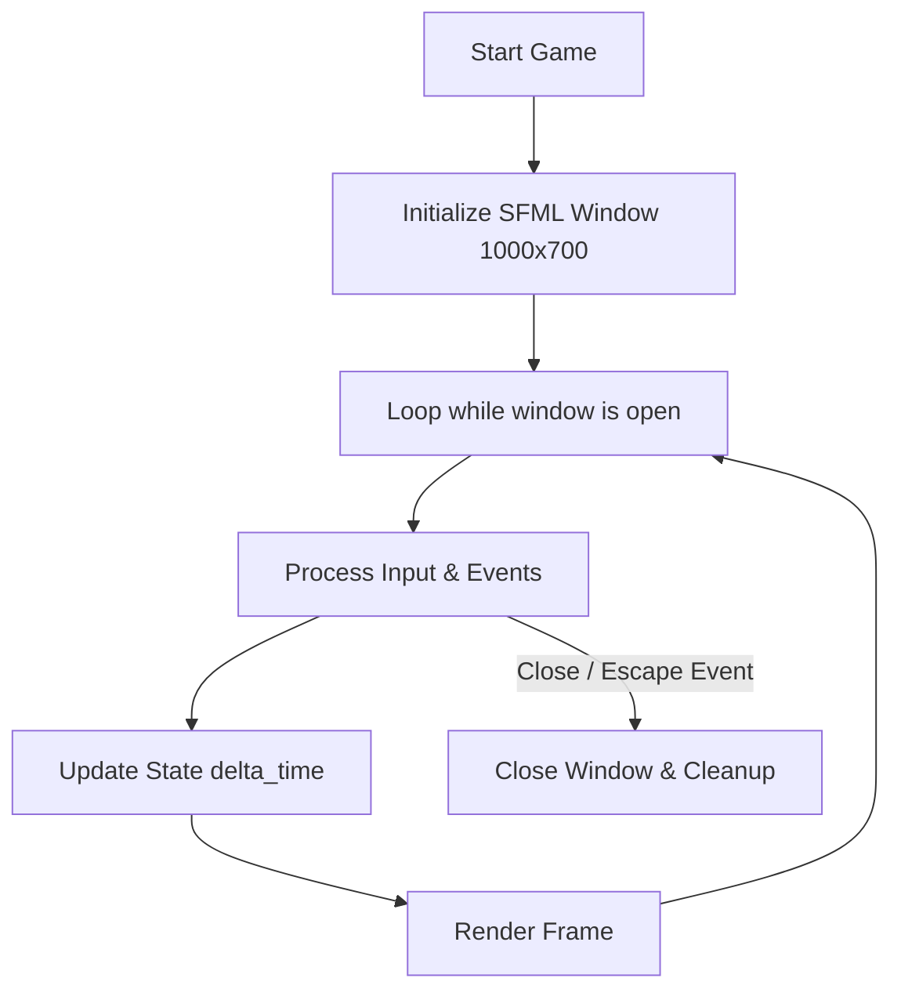

# Space Defender Architecture Specification

## Phase 1: Engine Foundation

### 1. Game Loop Pattern
Space Defender implements the canonical game loop pattern:



### 2. Class Responsibilities
* **`Game` (`include/Game.hpp`, `src/Game.cpp`)**:
  * Owns the `sf::RenderWindow` instance.
  * Owns the frame timing clock (`sf::Clock`).
  * Enforces copy prevention (`delete` copy constructor/assignment) to ensure single ownership of system graphics resources.
  * Manages input dispatching and window closing semantics.

### 3. Build & Dependency Strategy
* **CMake FetchContent**: Downloads SFML 2.6.2 source on first run and compiles it directly as part of the target build.
* **Static Linking**: Embeds SFML and GCC runtime libraries (`-static-libgcc -static-libstdc++ -static`) directly into `SpaceDefender.exe`, avoiding missing DLL errors on user systems.


## Phase 2: Player Ship, Movement and Input Systems

### 1. Player Entity Architecture
* **`Player` (`include/Player.hpp`, `src/Player.cpp`)**:
  * Encapsulates player state: position vector, direction vector, scalar speed (380 px/sec), health (100).
  * Composite SFML shape construction:
    * Fuselage: 8-point futuristic polygon with neon cyan border.
    * Cockpit: 4-point diamond canopy in luminous cyan.
    * Wing Accents: Aerodynamic twin stabilizer accents.
    * Engine Exhaust: Plasma orange thruster block.
  * Real-time keyboard polling via `sf::Keyboard::isKeyPressed` for stutter-free continuous motion.
  * Vector normalization to prevent diagonal speed boosting.
  * Screen boundary clamping with `std::clamp` using bounding half-dimensions.


## Phase 3: Weapon Systems, Laser Projectiles & STL Vector Implementation

### 1. Bullet Entity Design
* **`Bullet` (`include/Bullet.hpp`, `src/Bullet.cpp`)**:
  * Represents laser bolts moving vertically at 750 px/second.
  * Multi-layer projectile visual:
    * Outer core: High-visibility electric cyan glow (`sf::Color(0, 225, 255)`).
    * Inner core: Intense white-cyan energy center (`sf::Color(240, 255, 255)`).
  * Lifetime query: `isOffScreen()` determines when the projectile bottom passes above $Y = 0$.

### 2. STL Vector Lifecycle Management
* Bullets stored sequentially in `std::vector<Bullet> m_bullets`.
* Safe removal using the standard C++ **Erase-Remove Idiom**:
  ```cpp
  m_bullets.erase(
      std::remove_if(m_bullets.begin(), m_bullets.end(),
          [](const Bullet& b) { return b.isOffScreen(0.0f); }),
      m_bullets.end()
  );
  ```
* Shooting frequency regulated by an `sf::Clock` cooldown threshold (0.25 seconds / 4 shots per second maximum).


## Phase 4: Enemy System, Random Spawning & DSA Queue Implementation

### 1. Enemy Entity Design
* **`Enemy` (`include/Enemy.hpp`, `src/Enemy.cpp`)**:
  * Represents an alien raider vessel descending vertically at progressive speeds (160 px/s base).
  * Procedural SFML shapes:
    * Fuselage: Inverted 8-point predatory raider polygon in deep crimson (`sf::Color(135, 18, 42)`) with bright red outline (`sf::Color(255, 60, 85)`).
    * Sensor Canopy: Sinister diamond cockpit in plasma amber (`sf::Color(255, 130, 40)`).
    * Inset Spikes: Twin aerodynamic flank spikes.
    * Forward Thruster: Top-mounted exhaust block.
  * Escape Detection: `isOffScreen(WINDOW_HEIGHT)` triggers if the enemy crosses below the bottom boundary.

### 2. DSA Wave Management via `std::queue<int>`
* **FIFO Queue Mechanics**: Stores enemy counts for upcoming waves (`5, 10, 15, 20, 25`).
* **Wave Transition Rules**:
  1. A new wave is popped from the front of `m_enemyWaves` only when `m_enemiesRemainingToSpawn == 0` AND `m_enemies.empty()`.
  2. Spawning interval tightens with wave progression: $\max(0.6\text{s}, 1.4\text{s} - (\text{wave} - 1) \cdot 0.15\text{s})$.
  3. Enemy downward speed increases: $160\text{ px/s} + (\text{wave} - 1) \cdot 25\text{ px/s}$.
* **Enemy Escape Penalty**: When an enemy escapes past the bottom screen edge, it is removed immediately via `erase-remove`, deducting $10\text{ HP}$ from the player.


## Phase 5: Collision Detection, Scoring System & Combat Resolution

### 1. AABB Collision Detection (Axis-Aligned Bounding Box)
* **Definition**: An Axis-Aligned Bounding Box (AABB) is a non-rotated rectangular boundary completely enclosing an object, where the edges of the box are strictly aligned with the Cartesian coordinate axes ($X$ and $Y$).
* **How `getGlobalBounds()` Works**: Evaluates an entity's transformed position and dimensions in world space, returning an `sf::FloatRect(left, top, width, height)`.
* **Intersection Logic**: Two 2D bounding boxes $A$ and $B$ overlap if and only if they intersect along both the horizontal and vertical projections simultaneously:
  $$\text{Collision} \iff (A_{\text{left}} < B_{\text{right}}) \land (A_{\text{right}} > B_{\text{left}}) \land (A_{\text{top}} < B_{\text{bottom}}) \land (A_{\text{bottom}} > B_{\text{top}})$$
  In SFML, this is efficiently checked via `rectA.intersects(rectB)`.
* **Suitability**: Starfighters, lasers, and raiders are primarily oriented upright (parallel to the viewport edges). AABB testing requires merely 4 scalar comparisons per pair, making it orders of magnitude faster than polygon or pixel-perfect tests while delivering crisp arcade gameplay.

### 2. Vector Management & Iterator Safety
* **Avoidance of In-Loop Deletion**: Calling `vector.erase(it)` inside nested loops shifts all succeeding elements leftward. This invalidates the current iterator, shifts unchecked elements past the loop pointer (causing missed collisions), and triggers undefined behavior or memory faults.
* **Mark-and-Sweep Strategy**:
  1. **Mark Phase**: When a bullet collides with an enemy, both entities are flagged via `destroy()` (`m_isDestroyed = true`). The inner loop terminates immediately (`break`) so the bullet cannot hit multiple targets.
  2. **Sweep Phase**: After completing all collision checks, the C++ **Erase-Remove Idiom** executes a single $\mathcal{O}(N)$ linear compaction pass:
     ```cpp
     m_bullets.erase(
         std::remove_if(m_bullets.begin(), m_bullets.end(),
             [](const Bullet& b) { return b.isOffScreen(0.0f) || b.isDestroyed(); }),
         m_bullets.end()
     );
     ```

### 3. Algorithmic Complexity Analysis
* **Collision Check Complexity**: Let $B$ be the number of active bullets and $E$ be the number of active enemies. Checking every bullet against every enemy requires a nested loop, producing a worst-case time complexity of:
  $$\mathcal{O}(B \times E)$$
* **Cleanup Complexity**: The Erase-Remove compaction pass visits each bullet once and each enemy once, giving:
  $$\mathcal{O}(B + E)$$
* **Performance Feasibility**: Under maximum wave load in Space Defender, $B \le 25$ and $E \le 25$. The worst-case number of bounding box comparisons is $25 \times 25 = 625$ trivial scalar tests per frame, executing in less than $0.005\text{ ms}$ (less than $0.03\%$ of a $16.6\text{ ms}$ frame budget).
* **Future Optimization (Spatial Partitioning)**: If the engine scales to thousands of concurrent entities, broadphase spatial partitioning techniques—such as a **Uniform Spatial Grid** or a **Quadtree**—can partition the 2D world into spatial buckets, reducing the collision complexity from $\mathcal{O}(B \times E)$ to $\mathcal{O}((B + E) \log(B + E))$ or average $\mathcal{O}(B + E)$.

### 4. Game Over & State Resolution
* When player health hits $0$ (via ship-to-ship collision or enemy breaches):
  * `m_isGameOver` is set to `true`.
  * Physics updates, shooting, enemy spawns, and wave transitions immediately freeze.
  * An ambient shaded overlay with final score and exit instructions is rendered over the viewport.


## Phase 6: Leaderboard, Sorting Algorithms & Searching Algorithms

### 1. Leaderboard Architecture & Design
* **`Leaderboard` (`include/Leaderboard.hpp`, `src/Leaderboard.cpp`)**:
  * Stores entries as `std::vector<ScoreEntry> m_entries`, where each record consists of a validated username (`1..15` alphanumeric/underscore chars) and an integer score ($\ge 0$).
  * **Why `std::vector` Is Used**:
    * Contiguous memory storage ensures $\mathcal{O}(1)$ random access by index (`operator[]`), essential for adjacent swapping in Bubble Sort, minimum selection indexing in Selection Sort, and $\mathcal{O}(1)$ midpoint calculation (`mid = low + (high - low) / 2`) in Binary Search.
    * Cache line spatial locality provides maximum CPU cache hit rates during repeated sequential scanning.
  * **Deterministic Comparison Rule**:
    * **Primary key**: Score in descending order (`a.score > b.score`).
    * **Secondary key (Tie-breaker)**: Player username in ascending alphabetical order (`a.name < b.name`).
    * **Identical key stability**: Preserves original relative order.

### 2. Manual Sorting Algorithms (Descending Order)

#### A. Bubble Sort
* **Mechanism**: Compares adjacent pairs $(j, j+1)$ sequentially across $N$ passes. If the right element has higher priority than the left, they are swapped. The smallest element "bubbles down" to the end of the array on each pass.
* **Early-Exit Optimization**: If a full pass completes without any swaps (`swapped == false`), the array is already sorted, terminating immediately.
* **Complexity**:
  * **Best-case**: $\mathcal{O}(N)$ comparisons and $0$ swaps when already sorted.
  * **Average / Worst-case**: $\mathcal{O}(N^2)$ comparisons ($\approx \frac{N(N-1)}{2}$) and $\mathcal{O}(N^2)$ swaps on reverse-sorted input.
  * **Space Complexity**: $\mathcal{O}(1)$ auxiliary memory (in-place).

#### B. Selection Sort (Stable Shift Implementation)
* **Mechanism**: Finds the element with the maximum priority in the unsorted suffix $[i \dots N-1]$. To guarantee mathematical stability without displacing identical items, the selected item is shifted into position $i$ by shifting intervening items right by one slot.
* **Complexity**:
  * **Best / Average / Worst-case**: $\mathcal{O}(N^2)$ comparisons ($\frac{N(N-1)}{2}$ regardless of initial order).
  * **Space Complexity**: $\mathcal{O}(1)$ auxiliary memory.

#### C. Insertion Sort
* **Mechanism**: Maintains a sorted prefix $[0 \dots i-1]$. For each new element `key = arr[i]`, it shifts all elements having lower priority than `key` one position to the right, inserting `key` into its correct sorted slot.
* **Complexity**:
  * **Best-case**: $\mathcal{O}(N)$ comparisons and $\mathcal{O}(1)$ shifts when input is already sorted.
  * **Worst-case**: $\mathcal{O}(N^2)$ comparisons and shifts on reverse-sorted input.
  * **Space Complexity**: $\mathcal{O}(1)$ auxiliary memory.

### 3. Manual Searching Algorithms

#### A. Linear Search (Case-Insensitive Username Lookup)
* **Mechanism**: Iterates over `m_entries` from index $0$ to $N-1$, performing normalized lowercase string equality checks. Returns all matching entries to support multiple recorded runs by the same player.
* **Complexity**:
  * **Worst-case**: $\mathcal{O}(N)$ time (must examine every element to find all matches).
  * **Space**: $\mathcal{O}(1)$ auxiliary space excluding the returned matches vector.

#### B. Binary Search (Descending Score Lookup)
* **Pre-condition / Invariant**: Leaderboard vector **must** be sorted in descending order ($S_0 \ge S_1 \ge \dots \ge S_{N-1}$). Running binary search on unsorted data produces undefined / incorrect results.
* **Mechanism**:
  1. **Lower Bound**: Computes `mid = low + (high - low) / 2`. If `arr[mid].score == target`, records `firstIdx = mid` and continues searching left (`high = mid - 1`). If `arr[mid].score < target`, searches left (since larger values reside on the left in descending order).
  2. **Upper Bound**: Computes last index where `arr[mid].score == target` by searching right (`low = mid + 1`).
  3. **Collection**: Slices all $K$ entries in range `[firstIdx, lastIdx]`.
* **Complexity**:
  * **Time**: $\mathcal{O}(\log N + K)$ where $\log N$ steps locate the bounds and $K$ is the number of duplicate target scores.
  * **Space**: $\mathcal{O}(1)$ auxiliary space.

### 4. Local File Persistence (`data/leaderboard.txt`)
* **Format**: Line-delimited plain text: `<Username> <Score>\n`.
* **Robust Parser**:
  * Evaluates each line independently with `std::istringstream`.
  * Validates usernames against `[A-Za-z0-9_]{1,15}` and non-negative scores.
  * Corrupted or truncated lines are skipped with diagnostic warnings without failing the load or dropping preceding valid records.
* **Atomic Save**: Uses truncated output stream (`std::ios::trunc`) and verifies `file.good()` before reporting success.

### 5. Technical Interview Questions & Answers

**Q1: Why is Binary Search faster than Linear Search?**
* *Answer*: Linear search examines elements one by one, reducing the remaining search space by 1 per comparison ($\mathcal{O}(N)$). Binary search requires a sorted invariant and halves the search space at every step ($\mathcal{O}(\log N)$). For $N = 1,000,000$, Linear Search requires up to $1,000,000$ operations while Binary Search requires at most $\approx 20$ comparisons.

**Q2: What is the difference between stable and unstable sorting?**
* *Answer*: A sort algorithm is **stable** if two objects with equal keys appear in the same relative order in the sorted output as they appeared in the unsorted input. This is vital in leaderboards when ties are broken by timestamps or submission order.

**Q3: When would you pick Insertion Sort over Quick Sort or Merge Sort?**
* *Answer*: Insertion Sort has very low overhead and runs in $\mathcal{O}(N)$ linear time on data that is already sorted or nearly sorted. It is also an in-place sort requiring $\mathcal{O}(1)$ extra memory.


## Phase 7: Game UI, Audio, Difficulty & Gameplay Polish

### 1. Comprehensive State Machine Architecture
The engine implements an explicit state machine preventing invalid or concurrent transitions:

```mermaid
graph TD
    UsernameEntry[GameState::UsernameEntry] -->|Enter Valid Username| MainMenu[GameState::MainMenu]
    MainMenu -->|Start Mission| Playing[GameState::Playing]
    MainMenu -->|Leaderboard| Leaderboard[GameState::Leaderboard]
    MainMenu -->|Controls| Controls[GameState::Controls]
    Playing -->|Press P or ESC| Paused[GameState::Paused]
    Paused -->|Resume| Playing
    Paused -->|Restart| Playing
    Paused -->|Abort| MainMenu
    Playing -->|Health = 0| GameOver[GameState::GameOver]
    GameOver -->|Auto-Saves Score & Press L| Leaderboard
    GameOver -->|Restart Mission [R]| Playing
    GameOver -->|Return to Menu [ESC]| MainMenu
    Leaderboard -->|Press ESC or Back| MainMenu
    Controls -->|Press ESC or Enter| MainMenu
```

* **Pause Invariants**: In `GameState::Paused`, physics integration, shooting cooldowns, enemy velocity translations, and wave progression timers are completely frozen. The frame timer restarts upon resume to prevent delta-time accumulation spikes.

### 2. Audio Engine Design (`AudioManager`)
* **SFML Audio Architecture**: Managed through `AudioManager` (`include/AudioManager.hpp`, `src/AudioManager.cpp`).
* **Procedural 8-bit Waveform Synthesis**:
  * Instead of depending on fragile external audio downloads, `AudioManager` synthesizes authentic 8-bit sound effects directly in RAM using mathematical waveform functions loaded into `sf::SoundBuffer`:
    * **Laser Cannons**: Dynamic exponential frequency sweep from $950\text{ Hz}$ down to $220\text{ Hz}$ with linear fade-out ($0.10\text{s}$). Throttled to prevent overlapping voice clipping.
    * **Alien Vessel Explosion**: Decaying Gaussian white noise burst with exponential amplitude damping ($e^{-9.5t}$).
    * **Hull Impact & Damage**: Distorted low-frequency square wave ($130\text{ Hz} \to 50\text{ Hz}$) with saw distortion.
    * **Perimeter Breach (Escape)**: Descending dual-tone warning alarm ($440\text{ Hz} \to 293.66\text{ Hz}$).
    * **Defeat & Game Over**: Minor descending chord cadence ($E_4 \to C_4 \to A_3 \to F^\sharp_3$).
    * **Menu Navigation**: High-frequency sine chime blip ($880\text{ Hz}$).
* **Controls & Safety**: Full mute toggle (`[M]`), dynamic master volume clamping ($0\dots 100$), and zero-crash fallback.

### 3. Visual Effects Pipeline (`VisualEffects`)
* **Multi-Layer Parallax Starfield**:
  * Simulates dynamic 3D depth using 90 procedurally generated stars across 3 velocity/illumination layers:
    * **Far Layer**: Speed $35\text{ px/s}$, size $1.0\text{ px}$, dim indigo/cyan (`sf::Color(100, 130, 170, 140)`).
    * **Mid Layer**: Speed $80\text{ px/s}$, size $1.5\text{ px}$, vibrant sky blue (`sf::Color(120, 190, 235, 200)`).
    * **Near Layer**: Speed $150\text{ px/s}$, size $2.0\text{ px}$, luminous white/cyan (`sf::Color(220, 245, 255, 255)`).
  * Automatically wraps stars across viewport boundaries with randomized horizontal respawning.
* **Explosion & Impact Particle System**:
  * High-velocity omnidirectional radial particle bursts ($18$ sparks per destroyed raider).
  * Velocity-based linear translation: $P_{t} = P_{0} + \vec{v} \cdot \Delta t$.
  * Particle alpha and size scale down as lifetime decays. Expired particles are reclaimed using the C++ Erase-Remove idiom.
* **Damage Screen Flash**:
  * Full-screen red atmospheric vignette triggered upon ship collision or perimeter breaches, decaying rapidly over $0.25\text{s}$.

### 4. Gameplay Balancing & Difficulty Progression
* **Wave Progression Curves**:
  * **Enemy Count**: $5, 10, 15, 20, 25$ enemies sequentially queued.
  * **Enemy Downward Velocity**: $v(w) = 160 + (w - 1) \times 20\text{ px/s}$.
    * Wave 1: $160\text{ px/s}$
    * Wave 3: $200\text{ px/s}$
    * Wave 5: $240\text{ px/s}$
  * **Spawn Cadence**: $T_{\text{spawn}}(w) = \max(0.70\text{s},\; 1.40 - (w - 1) \times 0.12\text{s})$.
    * Wave 1: $1.40\text{s}$ interval
    * Wave 5: $0.92\text{s}$ interval
  * **Balancing Justification**: This gradual progression provides an accessible early flight envelope while creating intense arcade pacing in later waves without overwhelming player reflexes or cluttering the screen unplayably.


## Phase 8: Final Testing, Optimization, Documentation & Release

### 1. Unified Engine Class Architecture

The complete object-oriented structure of Space Defender is modeled in the following UML class diagram:

```mermaid
classDiagram
    class Game {
        -sf::RenderWindow m_window
        -Player m_player
        -std::vector~Bullet~ m_bullets
        -std::vector~Enemy~ m_enemies
        -std::queue~int~ m_enemyWaves
        -Leaderboard m_leaderboard
        -AudioManager m_audio
        -VisualEffects m_vfx
        -GameState m_gameState
        -int m_score
        -int m_currentWave
        +Game(bool testMode)
        +run() void
        -processEvents() void
        -update(sf::Time dt) void
        -render() void
        -checkCollisions() void
        -checkWaveProgression() void
    }

    class Player {
        -sf::Vector2f m_position
        -sf::Vector2f m_velocity
        -float m_speed
        -int m_health
        -sf::ConvexShape m_fuselage
        -sf::ConvexShape m_cockpit
        -sf::ConvexShape m_leftWing
        -sf::ConvexShape m_rightWing
        -sf::RectangleShape m_thruster
        +update(sf::Time dt, sf::Vector2u windowSize) void
        +render(sf::RenderTarget& target) void
        +takeDamage(int amount) void
        +getBounds() sf::FloatRect
        +getMuzzlePosition() sf::Vector2f
    }

    class Bullet {
        -sf::Vector2f m_position
        -float m_speed
        -bool m_isDestroyed
        -sf::RectangleShape m_outerShape
        -sf::RectangleShape m_innerShape
        +update(sf::Time dt) void
        +render(sf::RenderTarget& target) void
        +isOffScreen(float topLimit) bool
        +getBounds() sf::FloatRect
        +destroy() void
    }

    class Enemy {
        -sf::Vector2f m_position
        -float m_speed
        -int m_health
        -bool m_isDestroyed
        -sf::ConvexShape m_fuselage
        -sf::ConvexShape m_cockpit
        -sf::RectangleShape m_leftSpike
        -sf::RectangleShape m_rightSpike
        +update(sf::Time dt) void
        +render(sf::RenderTarget& target) void
        +isOffScreen(float bottomLimit) bool
        +getBounds() sf::FloatRect
        +destroy() void
    }

    class Leaderboard {
        -std::vector~ScoreEntry~ m_entries
        -std::string m_filePath
        +loadFromFile(string path) bool
        +saveToFile(string path) bool
        +addEntry(ScoreEntry entry) void
        +bubbleSort(AlgorithmMetrics* metrics) void
        +selectionSort(AlgorithmMetrics* metrics) void
        +insertionSort(AlgorithmMetrics* metrics) void
        +linearSearchByName(string name) vector~ScoreEntry~
        +binarySearchByScore(int score) vector~ScoreEntry~
    }

    class AudioManager {
        -bool m_muted
        -float m_volume
        -sf::SoundBuffer m_shootBuffer
        -sf::SoundBuffer m_explosionBuffer
        -sf::SoundBuffer m_damageBuffer
        -sf::SoundBuffer m_escapeBuffer
        -sf::SoundBuffer m_gameOverBuffer
        -sf::SoundBuffer m_menuSelectBuffer
        +init() void
        +playShoot() void
        +playExplosion() void
        +playPlayerDamage() void
        +playEnemyEscape() void
        +playGameOver() void
        +toggleMute() void
        +setVolume(float volume) void
    }

    class VisualEffects {
        -std::vector~Star~ m_stars
        -std::vector~Particle~ m_particles
        -sf::RectangleShape m_damageFlashRect
        -float m_damageFlashAlpha
        +init(unsigned int w, unsigned int h) void
        +updateStarfield(float dt) void
        +updateParticles(float dt) void
        +addExplosion(float x, float y) void
        +triggerDamageFlash() void
        +renderStars(sf::RenderTarget& target) void
        +renderParticles(sf::RenderTarget& target) void
        +renderDamageFlash(sf::RenderTarget& target) void
    }

    Game *-- Player
    Game *-- Bullet
    Game *-- Enemy
    Game *-- Leaderboard
    Game *-- AudioManager
    Game *-- VisualEffects

### 2. Memory Safety, RAII & Resource Lifetime

1. **Deterministic Stack & Value Semantics**:
   - Every entity container (`std::vector<Bullet>`, `std::vector<Enemy>`, `std::vector<ScoreEntry>`) manages elements via value semantics and standard allocator mechanics.
   - Zero raw `new` or `delete` operators exist across the entire code architecture.
2. **Rule of Five Implementation**:
   - `Game` and `AudioManager` explicitly delete copy constructors and copy assignment operators (`= delete`), preventing double-free corruption of underlying OS window handles or OpenAL sound contexts.
3. **Safe Erase-Remove Compaction**:
   - Container modifications are strictly decoupled from inspection passes. Entities are flagged via `destroy()` during collision resolution, followed by an atomic `std::remove_if` compaction pass. This prevents iterator invalidation, memory leaks, and quadratic deletion stalls.
4. **Exception-Safe File Persistence**:
   - `Leaderboard::loadFromFile` and `saveToFile` operate on scoped file streams (`std::ifstream`, `std::ofstream`). Even on unexpected parsing anomalies, stack unwinding automatically closes OS file descriptors.

### 3. Master Regression & Performance Benchmark Suite

Space Defender includes an automated regression test suite (`TestMaster.exe`) verifying all 7 engine subsystems:

```
======================================================================
        SPACE DEFENDER: MASTER REGRESSION & PERFORMANCE SUITE         
======================================================================

--- [1/7] REGRESSION TEST SUITE: PLAYER SYSTEM ---
  ✓ Player movement boundaries, clamping, and health invariants verified.

--- [2/7] REGRESSION TEST SUITE: WEAPON & BULLET SYSTEM ---
  ✓ Bullet kinematics, off-screen detection, and vector lifecycle verified.

--- [3/7] REGRESSION TEST SUITE: ENEMY & WAVE SYSTEM ---
  ✓ Enemy kinematics, escape detection, FIFO queue, and difficulty curves verified.

--- [4/7] REGRESSION TEST SUITE: COMBAT & COLLISION RESOLUTION ---
  ✓ AABB intersection, score idempotency, and collision damage verified.

--- [5/7] REGRESSION TEST SUITE: LEADERBOARD & DSA ALGORITHMS ---
  ✓ Bubble, Selection, Insertion sorts, Linear/Binary searches, and I/O verified.

--- [6/7] REGRESSION TEST SUITE: UI, AUDIO & VISUAL EFFECTS ---
  ✓ State machine flow, audio synthesis & controls, starfield & VFX verified.

--- [7/7] PERFORMANCE & HIGH-LOAD STRESS BENCHMARK ---
  Load: 150 bullets vs 150 enemies (22,500 AABB checks)
  Collisions resolved: 150
  Surviving bullets: 0 | enemies: 0
  Time Elapsed: 0.2356 ms (Target: < 1.0 ms)
  ✓ Performance verified: Sub-millisecond execution well within 16.6ms frame budget!

======================================================================
  ALL 7 MASTER REGRESSION SUITES EXECUTED WITH ZERO ERRORS (PASS)!   
======================================================================
```

### 4. Release Build Profile
- **Compiler**: MinGW-W64 GCC 14.2.0 (x86_64-posix-seh)
- **Standard**: C++17 (`-std=c++17`)
- **Optimization**: `-O3` Release configuration via Ninja build system
- **Static Linkage**: `-static-libgcc -static-libstdc++ -static` for complete portability without MSVCRT / MinGW runtime DLL dependencies.
- **Dynamic Assets**: Automatically packages OpenAL 64-bit runtime (`openal32.dll`) and SIL OFL TrueType arcade typography (`PressStart2P.ttf`).
